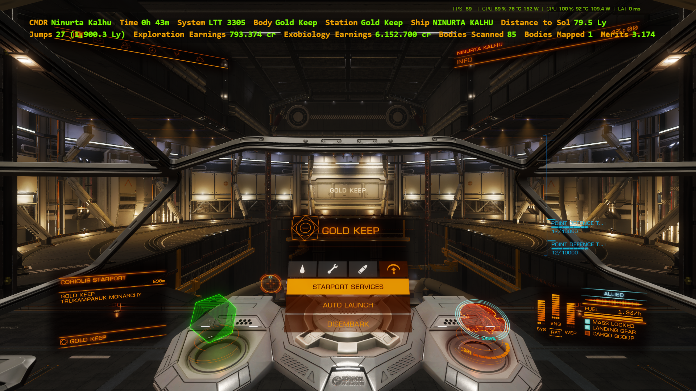
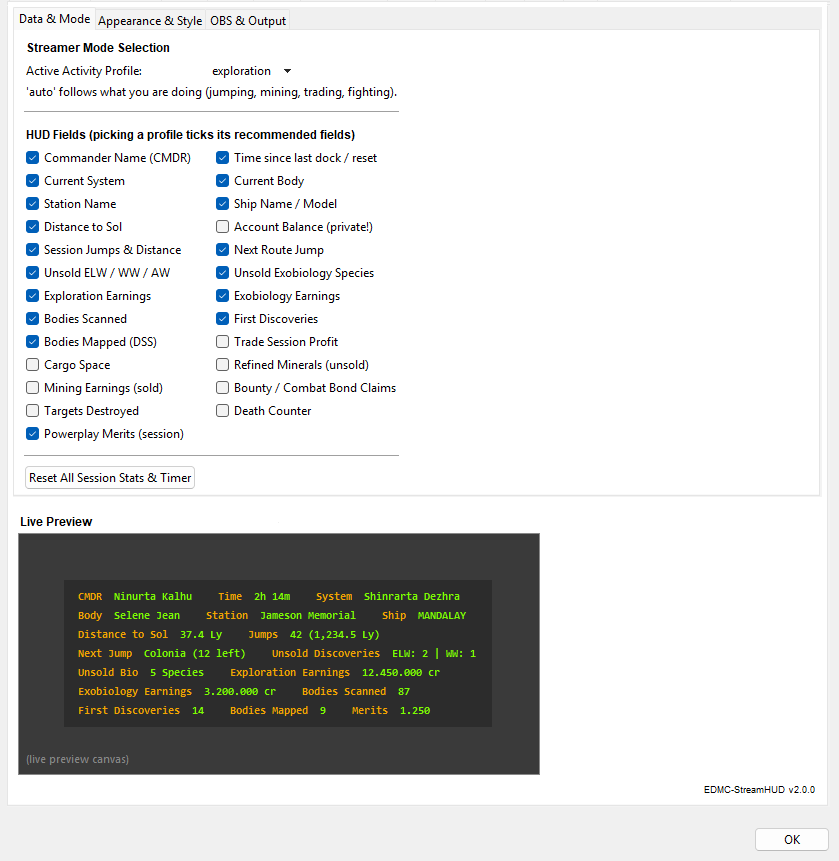
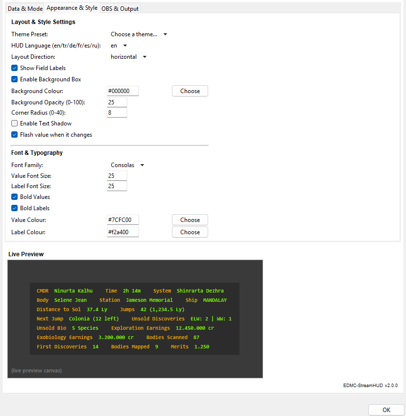
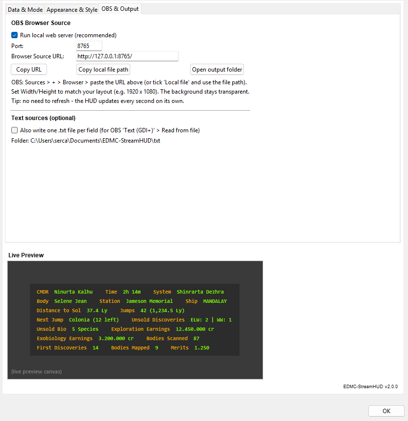

# EDMC-StreamHUD v2.0.0

A live, fully customisable Elite Dangerous HUD for OBS. It runs as an [EDMC](https://github.com/EDCD/EDMarketConnector) plugin, reads your game journal and shows session statistics as an OBS Browser Source (or as plain text files). It is built for every kind of commander: explorers, exobiologists, traders, miners and combat pilots.

## Contents
1. [Requirements](#requirements)
2. [Installation](#installation)
3. [Adding the HUD to OBS](#adding-the-hud-to-obs)
4. [Profiles and automatic mode](#profiles-and-automatic-mode)
5. [Field reference](#field-reference)
6. [Settings reference](#settings-reference)
7. [Output files](#output-files)
8. [How the counters work](#how-the-counters-work)
9. [Known limitations](#known-limitations)
10. [Troubleshooting](#troubleshooting)
11. [Privacy and security](#privacy-and-security)
12. [Licence](#licence)

## Requirements
- Elite Dangerous (Horizons or Odyssey) and OBS Studio.
- EDMC (tested with 6.1.2) running while you play. The plugin only reads journal events that EDMC passes to it.
- Python is bundled with EDMC; nothing extra needs to be installed.

## Installation
1. Download `EDMC-StreamHUD.zip` and extract it. You should have a folder named `EDMC-StreamHUD` containing `load.py`.
2. In EDMC choose **File > Settings > Plugins > Open** (this opens the `plugins` folder), copy the `EDMC-StreamHUD` folder into it and restart EDMC.
3. Open **File > Settings > EDMC-StreamHUD**. You should see three tabs: *Data & Mode*, *Appearance & Style* and *OBS & Output*.

To update, replace `load.py` inside the plugin folder and restart EDMC. Your settings and session totals are kept.

## Adding the HUD to OBS
**Recommended: Browser Source**
1. In OBS press `+` under *Sources* and choose **Browser**.
2. Paste the URL from *OBS & Output > Browser Source URL* (default `http://127.0.0.1:8765/`). The *Copy URL* button copies it for you.
3. Set Width and Height to suit your layout (for example 1920 x 1080 for a vertical HUD). The background of the page is transparent.
4. There is no need to refresh: the HUD checks for new data every second.

**Alternative: Local file.** Tick *Local file* in the Browser Source and use `Documents\EDMC-StreamHUD\HUD.html` (the *Copy local file path* button copies it). The local web server is more reliable, so use this only if you turned the server off.

**Alternative: Text sources.** Enable *Also write one .txt file per field*, then add an OBS *Text (GDI+)* source with *Read from file* pointing at the field's file in `Documents\EDMC-StreamHUD\txt\`.

## Profiles and automatic mode
A profile is a ready-made selection of fields. Choosing a profile in *Data & Mode* ticks its recommended fields, and you can then tick or untick anything you like.

| Profile | Fields ticked by default |
|---|---|
| exploration | CMDR, Time, System, Body, Station, Distance to Sol, Ship, Jumps, Next Jump, Unsold Discoveries, Unsold Bio, Exploration Earnings, Exobiology Earnings, Bodies Scanned, First Discoveries, Bodies Mapped, Merits |
| trade | CMDR, Time, System, Station, Ship, Jumps, Trade Session Profit, Cargo Space, Merits |
| mining | CMDR, Time, System, Body, Ship, Cargo Space, Refined Minerals, Mining Earnings, Merits |
| combat | CMDR, Time, System, Ship, Bounty / Bond Claim, Targets Destroyed, Deaths, Merits |

**auto** follows what you are doing and shows only the fields of the matching profile:
- jumping or scanning: exploration
- buying or selling cargo and commodities: trade
- refining, prospecting or launching limpets/drones: mining (selling your mined haul keeps you in mining)
- bounties, bonds, PvP kills or being attacked: combat

The account balance is never switched on by a profile or by auto mode (see [Privacy](#privacy-and-security)).

## Field reference
A field is hidden while it has nothing to show (for example Deaths stays hidden at 0).

| Field | What it shows |
|---|---|
| CMDR | Your commander name. |
| Time | Time since your last dock or since the last session reset. |
| System | Current system. |
| Body | Current body or nearest body. |
| Station | Current station, or *Deep Space*. |
| Ship | Current ship name. |
| Distance to Sol | Distance from Sol in light years. |
| Balance | Account balance (off by default). |
| Jumps | Session jump count with total distance, for example `12 (310.4 Ly)`. |
| Next Jump | Next system in your plotted route with jumps remaining. |
| Unsold Discoveries | Unsold high-value worlds found this session (ELW, WW, AW). |
| Unsold Bio | Unsold exobiology species scanned this session. |
| Exploration Earnings | Exploration data sold this session. |
| Exobiology Earnings | Exobiology data sold this session. |
| Bodies Scanned | Bodies scanned this session. |
| First Discoveries | Bodies you were first to discover. |
| Bodies Mapped | Bodies mapped with the surface scanner (DSS). |
| Trade Session Profit | Profit from commodity trading this session (mined minerals excluded). |
| Cargo Space | Cargo carried against capacity, for example `15 / 752 t`. |
| Refined Minerals | Refined minerals currently in the hold, by type. Drops when you sell, jettison or die. |
| Mining Earnings | Credits earned from selling mined minerals this session. |
| Bounty / Bond Claim | Combat bounty and bond rewards earned this session. |
| Targets Destroyed | Ships destroyed (Bounty, faction/capital-ship bonds, PvP kills, rival-Power ships). |
| Deaths | Times your ship was destroyed. |
| Merits | Powerplay merits earned this session. |

## Settings reference
Changes made in EDMC's settings window apply when you press **OK**. The *Live Preview* at the bottom of the window shows your layout, theme and commander name.

### Data & Mode
- **Active Activity Profile**: exploration, trade, mining, combat or auto.
- **HUD Fields**: a checkbox for each field.
- **Reset All Session Stats & Timer**: sets every session counter, merits and the timer back to zero.

### Appearance & Style
- **Theme Preset**: Cyber Cyan (default), Elite Orange, Terminal Green, Hologram Blue, Minimal (no box), Light Card.
- **HUD Language**: en, tr, de, fr, es, ru (field labels on the HUD).
- **Layout Direction**: *vertical* (one field per line) or *horizontal* (left to right; fields wrap onto the next line at the edge of the frame, so nothing is cut off in OBS).
- **Show Field Labels**, **Enable Background Box**, **Background Colour**, **Background Opacity (0-100)**, **Corner Radius (0-40)**, **Enable Text Shadow**, **Flash value when it changes**.
- **Font Family**, **Value Font Size**, **Label Font Size**, **Bold Values**, **Bold Labels**, **Value Colour**, **Label Colour**. Colours are `#RRGGBB`; the *Choose* button opens a colour picker.

### OBS & Output
- **Run local web server (recommended)**: serves the HUD on `127.0.0.1`.
- **Port**: default 8765 (allowed range 1024-65535). If you change it, update the URL in OBS.
- **Browser Source URL**, **Copy URL**, **Copy local file path**, **Open output folder**.
- **Also write one .txt file per field**: for OBS text sources.

## Output files
Everything is written to `Documents\EDMC-StreamHUD\`:

| File | Purpose |
|---|---|
| `HUD.html` | The page OBS displays. |
| `HUD.json` | Current value of every field, or `"HIDE"` for hidden fields. Useful for your own overlays or bots. |
| `settings.json` | Your settings. |
| `totals_and_state.json` | Session totals, so an EDMC restart does not lose them. |
| `txt\<field>.txt` | One file per field, if enabled. |

Files are written atomically, so OBS never reads a half-written file.

## How the counters work
- **Persistence**: totals survive an EDMC restart. If the same journal lines are replayed, they are not counted twice.
- **Unsold discoveries and bio** count each body or species once, even if you scan it again.
- **Mining**: Refined Minerals shows what is in the hold. When you sell a mined commodity, its income goes to *Mining Earnings* and does not inflate *Trade Session Profit*.
- **Merits** follow the game's own `TotalMerits` figure. Straight after a mission payout the game briefly reports inflated or repeated totals. For 20 seconds after a mission completes, one award is counted per completed mission and repeated lines are ignored; the real total corrects itself at the next merit event.
- **Rival-Power ship kills** leave no bounty in the journal. A kill is counted when your target lock is lost and merits follow within 3 seconds. It is never double-counted with a Bounty or bond line.

## Known limitations
- Kills that produce no bounty, bond or merit line cannot be seen in the journal, so no plugin can count them.
- Merit rules after mission payouts were fitted to real journal samples. In unusual cases the figure can be briefly off until the next merit event.
- The plugin only knows what EDMC passes it, so events that happen while EDMC is closed are not counted.

## Troubleshooting
- **The HUD is empty in OBS**: check that EDMC is running and the plugin tab appears in settings; that the URL matches the port in *OBS & Output*; and that at least one field has a value to show.
- **Port already in use**: choose another port (for example 8766), press OK, and update the OBS URL.
- **A field is missing**: it is hidden while empty, hidden by auto mode (it belongs to another profile), or unticked in *Data & Mode*.
- **Fields run out of the frame**: enlarge the Browser Source, reduce the font sizes, or switch *Layout Direction* to horizontal.
- **Changes do not appear**: press OK in EDMC's settings; the HUD then updates within a second.
- **Start fresh**: use *Reset All Session Stats & Timer*, or close EDMC and delete `totals_and_state.json`.
- **Plugin does not load**: the folder must be named `EDMC-StreamHUD` and contain `load.py` directly (not an extra nested folder). Check EDMC's log for errors.

## Privacy and security
- The account balance (`credits`) is never enabled automatically by any profile.
- The web server listens on `127.0.0.1` only (your own computer) and serves only `HUD.html` and `HUD.json`. Other files, including `settings.json`, return 404.
- Nothing is sent over the internet. "Just Reading, Not Sending! <3"

## Licence
GPL-3.0-or-later.

